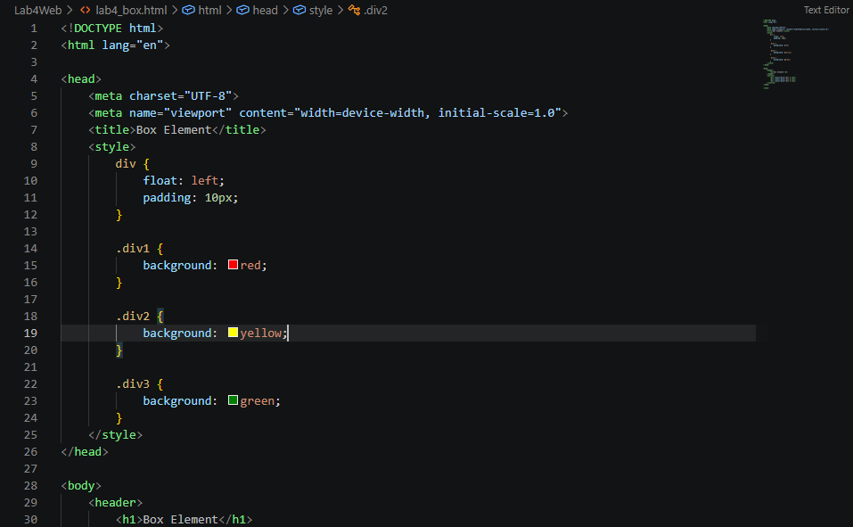
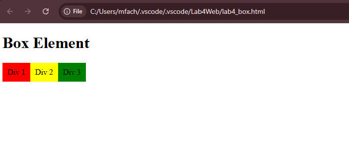
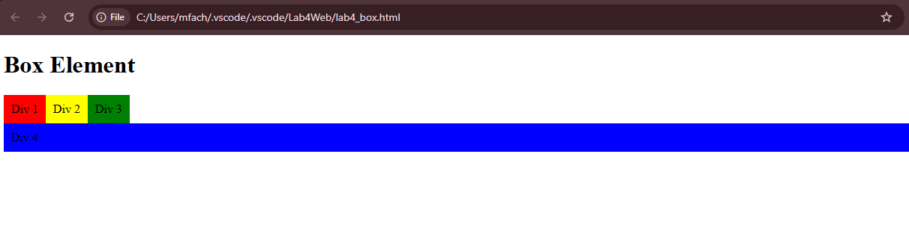
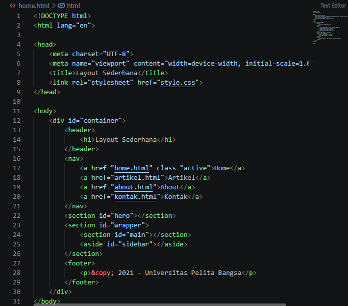
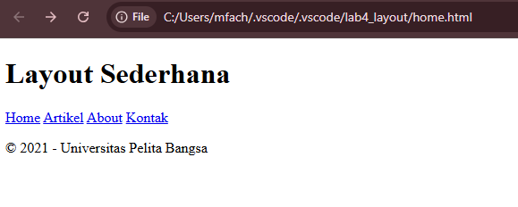
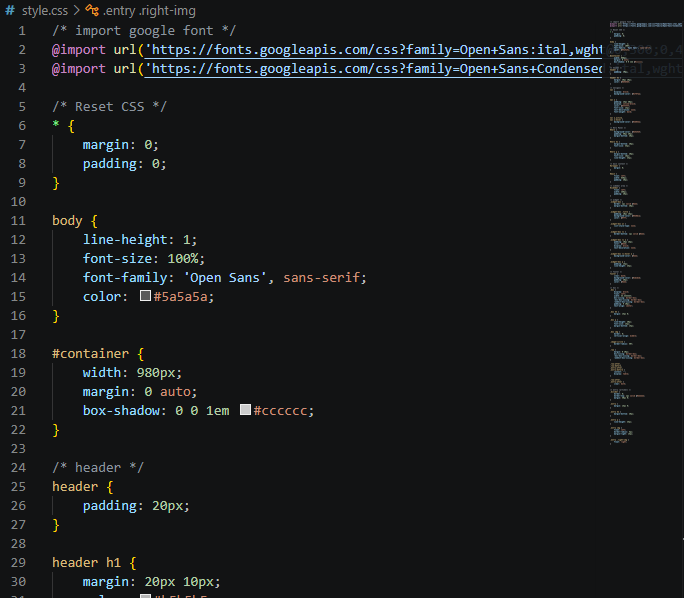
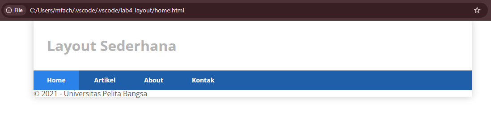
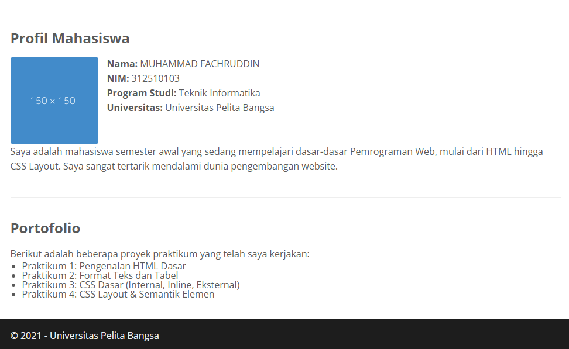
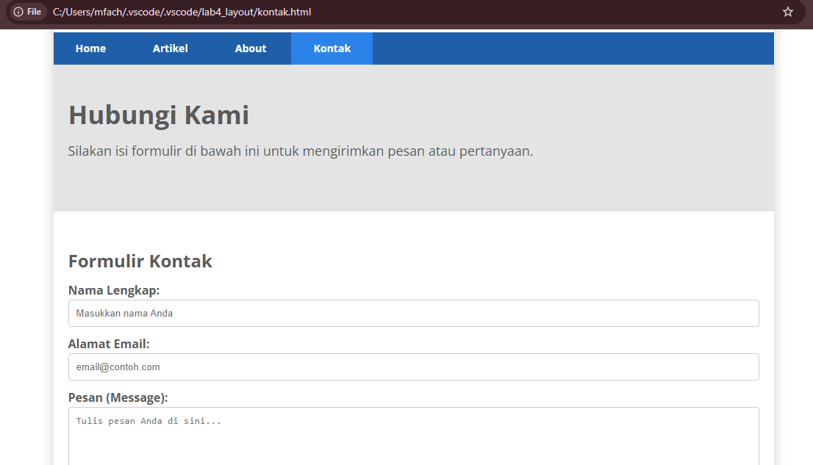

# lab4web
# Laporan Praktikum 4: CSS Layout
**Mata Kuliah:** Pemrograman Web  
**Nama:** MUHAMMAD FACHRUDDIN  
**NIM:** 312510103  

---

## 1. Box Element & Clearfix (`lab4_box.html`)
Praktikum diawali dengan memahami konsep dasar Layout menggunakan *Box Element* dan *CSS Float*. Elemen HTML (khususnya `div`) diperlakukan sebagai kotak yang disusun bersampingan menggunakan properti `float: left`. Untuk menghentikan efek *float* agar elemen selanjutnya turun ke baris baru, digunakan properti `clear: left`.

- **Kode di VS Code:**
  
- **Hasil Browser:**
  

---

## 2. Membuat Layout Sederhana (`lab4_layout`)
Tahap kedua adalah merancang kerangka *website* lengkap menggunakan *Semantic Elements HTML5* (`<header>`, `<nav>`, `<section>`, `<aside>`, `<footer>`) yang dipadukan dengan *CSS Styling*.

### a. Kerangka Dasar & Navigasi
File `home.html` dibuat dengan struktur dasar *Semantic HTML*, lalu dihubungkan dengan file `style.css` eksternal. Elemen `header` dan `nav` diberi gaya CSS untuk membuat area navigasi berwarna biru.
- **Kode Navigasi CSS:**
  
- **Hasil Browser:**
  

### b. Hero Panel
Bagian `<section id="hero">` ditambahkan dan diberi *styling* abu-abu besar untuk bertindak sebagai *banner* sambutan di bawah navigasi.
- **Kode Hero Panel:**
  
- **Hasil Browser:**
  

### c. Sidebar, Main Content & Footer
Area utama dibagi menjadi dua bagian dengan CSS `float`: kiri untuk konten utama (`#main`), dan kanan untuk *sidebar* (`#sidebar`). Elemen `footer` diberi warna gelap di bagian paling bawah menggunakan `clear: both`.
- **Kode CSS Layout:**
  
- **Hasil Browser Akhir (`home.html`):**
  

---

## 3. Tugas Tambahan
Sesuai instruksi modul, ditambahkan dua halaman baru yang terhubung dengan menu navigasi, yaitu halaman **About** dan **Kontak**. Keduanya menggunakan file `style.css` yang sama dengan modifikasi *inline style* untuk lebar layout tunggal.

- **Halaman About (`about.html`):** 
  Berisi profil mahasiswa dan portofolio singkat tanpa *sidebar*.
  

- **Halaman Kontak (`kontak.html`):** 
  Berisi formulir interaktif sederhana yang mencakup Nama, Email, dan Pesan.
  
